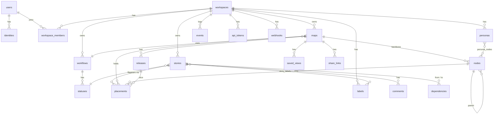

# oh-my-story — data model

Full v1 model, with the milestone in which each table is first migrated. Source of truth for scope is `PLAN.md`; this file only shapes the data.

## Conventions

- **IDs:** `uuid`, generated app-side as UUIDv7 (time-ordered, index-friendly). Exposed as-is in the API.
- **Timestamps:** `timestamptz`, `created_at` / `updated_at` on every mutable table. UTC.
- **Ordering:** `rank text` using fractional indexing (lexicographic, e.g. `a0`, `a0V`, `a1`). A move rewrites one row, not its siblings. Collate `"C"`, unique among siblings (`NULLS NOT DISTINCT` where the scope has a nullable column).
- **Soft delete:** `deleted_at timestamptz` on `maps`, `nodes`, `stories`, `comments`. Everything else hard-deletes. The `events` log keeps the history either way.
- **Tenancy:** every row reaches a `workspace_id`, directly or through its map. Queries always filter by it.
- **External refs:** `ext_system text, ext_key text, ext_url text` (all nullable; system and key set together) on `nodes` and `stories`. Unique on `(ext_system, ext_key)` where set: per workspace for stories, per map for nodes, which have no `workspace_id`.
- **Concurrency:** last-write-wins per field. `version int` on `stories` and `nodes`, bumped on write, used only to detect and report stale drags, not to reject edits.

## Entity overview



## Key design decisions

1. **Stories belong to the workspace, not the map.** A story's position lives in `placements`. Linked maps are then just a second placement row. A story with zero placements is a backlog item.
2. **Backbone is one `nodes` table.** `level` is `objective | activity | step`. A 3-level map has no `objective` rows. A `CHECK` plus a constraint trigger enforces the parent level: step → activity, activity → objective (4-level) or null (3-level).
3. **Statuses are rows.** `workflows` own ordered `statuses`, each with a `category` (`todo | doing | done | blocked`) so roll-ups and the roadmap never depend on custom names. A map points at one workflow.
4. **Roles are per workspace** in v1. Map-level overrides are deferred: add a nullable `map_members` table later without touching existing rows.
5. **`events` is append-only and the single feed** for real-time, audit, webhooks and Mattermost. Written in the same transaction as the mutation, then `pg_notify('events', id)`.

## Tables

### Identity and access (M0)

```sql
users (
  id uuid pk, email citext unique not null, display_name text not null,
  avatar_url text, password_hash text,          -- null for OIDC-only users
  is_active bool not null default true,
  created_at, updated_at
)

identities (                                     -- OIDC links
  id uuid pk, user_id fk users on delete cascade,
  issuer text not null, subject text not null,
  unique (issuer, subject)
)

sessions (
  id uuid pk, user_id fk, token_hash bytea unique not null,
  expires_at timestamptz not null, user_agent text, ip inet, created_at
)

workspaces (
  id uuid pk, name text not null, slug citext unique not null,
  key_prefix text not null default 'STORY',      -- story keys: STORY-142
  next_story_seq int not null default 1,
  estimate_unit text not null default 'points',  -- label only: points, days, ...
  created_at, updated_at
)

workspace_members (
  workspace_id fk, user_id fk,
  role text not null check (role in ('owner','admin','editor','commenter','viewer')),
  primary key (workspace_id, user_id)
)

invites (
  id uuid pk, workspace_id fk, email citext not null, role text not null,
  token_hash bytea unique not null, invited_by fk users,
  expires_at, accepted_at
)
```

Role capabilities: `owner` all incl. delete workspace; `admin` members, workflows, tokens, webhooks; `editor` all map and story edits; `commenter` comments only; `viewer` read only.

### Workflows (M1)

```sql
workflows (
  id uuid pk, workspace_id fk, name text not null, is_default bool not null default false
)                                                -- one default per workspace (partial unique index)

statuses (
  id uuid pk, workflow_id fk on delete cascade,
  name text not null, category text not null check (category in ('todo','doing','done','blocked')),
  colour text, rank text not null,
  ext_name text,                                 -- Jira status name for later sync
  unique (workflow_id, name)
)
```

Deleting a status requires reassigning its stories to another status in the same workflow (enforced in the service, `ON DELETE RESTRICT` in the schema).

### The map (M1)

```sql
maps (
  id uuid pk, workspace_id fk, workflow_id fk workflows,
  name text not null, description text,
  levels smallint not null check (levels in (3,4)),   -- immutable after the first node exists
  deleted_at, created_at, updated_at
)

nodes (                                          -- backbone
  id uuid pk, map_id fk, parent_id fk nodes,
  level text not null check (level in ('objective','activity','step')),
  title text not null, description text, colour text,
  rank text not null,                            -- among siblings
  version int not null default 0,
  ext_system, ext_key, ext_url,
  deleted_at, created_at, updated_at
)
-- index (map_id, parent_id, rank)

releases (
  id uuid pk, map_id fk, name text not null, description text,
  target_date date, rank text not null,          -- top to bottom order on the map
  created_at, updated_at
)                                                -- an implicit "Unscheduled" slice is the placement with release_id null

stories (
  id uuid pk, workspace_id fk,
  key text not null,                             -- human key, e.g. STORY-142, unique per workspace
  title text not null, description_md text not null default '',
  status_id fk statuses, estimate numeric(6,2),  -- unit set per workspace (points / days)
  assignee_id fk users, created_by fk users,
  version int not null default 0,
  ext_system, ext_key, ext_url,
  search tsvector generated always as (...) stored,   -- title + description, GIN
  deleted_at, created_at, updated_at,
  unique (workspace_id, key)
)

placements (                                     -- where a story sits on a map
  id uuid pk, story_id fk stories on delete cascade, map_id fk maps,
  step_id fk nodes,                              -- must be level = 'step'
  release_id fk releases,                        -- null = unscheduled
  rank text not null,                            -- within the (step, release) cell
  unique (story_id, map_id)                      -- a story appears once per map
)
-- index (map_id, step_id, release_id, rank)
```

`workspaces.next_story_seq` backs `stories.key` (incremented in the insert transaction).

### Planning (M2)

```sql
personas (
  id uuid pk, workspace_id fk, name text not null, description text, colour text
)
persona_nodes (                                  -- personas linked to activities
  persona_id fk, node_id fk,                     -- node.level = 'activity'
  primary key (persona_id, node_id)
)

labels ( id uuid pk, workspace_id fk, name citext not null, colour text, unique (workspace_id, name) )
story_labels ( story_id fk, label_id fk, primary key (story_id, label_id) )

comments (
  id uuid pk, story_id fk, author_id fk users,
  body_md text not null, parent_id fk comments,  -- one level of threading
  resolved_at, edited_at, deleted_at, created_at
)
mentions ( comment_id fk, user_id fk, primary key (comment_id, user_id) )

saved_views (
  id uuid pk, map_id fk, name text not null, created_by fk users,
  filter jsonb not null,                         -- {labels, statuses, assignees, personas, text, release}
  is_shared bool not null default false, created_at
)
```

Estimate roll-ups are computed, not stored: a recursive CTE over `nodes` summing `stories.estimate` through `placements`, grouped by release. Revisit with a materialised view only if it measures slow.

### Sharing (M3)

```sql
share_links (
  id uuid pk, map_id fk, token_hash bytea unique not null,
  created_by fk users, expires_at, revoked_at, created_at
)                                                -- read-only, anonymous, no comments
```

### Connected (M4)

```sql
dependencies (
  id uuid pk, workspace_id fk,
  from_story_id fk stories, to_story_id fk stories,   -- "from blocks to"
  created_by fk users, created_at,
  check (from_story_id <> to_story_id),
  unique (from_story_id, to_story_id)
)

api_tokens (
  id uuid pk, workspace_id fk, name text not null,
  token_hash bytea unique not null, prefix text not null,   -- shown in UI
  scope text not null check (scope in ('read','write')),
  created_by fk users, last_used_at, expires_at, revoked_at, created_at
)

webhooks (
  id uuid pk, workspace_id fk, url text not null, secret text not null,
  event_types text[] not null, is_active bool not null default true, created_at
)
webhook_deliveries (
  id uuid pk, webhook_id fk, event_id fk events,
  status_code int, attempt int not null default 0,
  next_attempt_at, delivered_at, last_error text
)

integrations (                                   -- Mattermost now, others later
  id uuid pk, workspace_id fk, kind text not null,   -- 'mattermost'
  config jsonb not null,                         -- webhook URL etc., secrets encrypted
  event_types text[] not null, is_active bool not null default true
)
```

Dependency cycles are rejected in the service layer (graph walk on insert).

### Event log (M1)

```sql
events (
  id bigint generated always as identity pk,     -- monotonic: clients resume with "after id"
  workspace_id fk, map_id fk null,
  actor_id fk users null,                        -- null for system / API token (see actor_kind)
  actor_kind text not null,                      -- 'user' | 'token' | 'system'
  entity_type text not null,                     -- 'story','node','placement','release','comment',...
  entity_id uuid not null,
  action text not null,                          -- 'create','update','move','delete','restore'
  before jsonb, after jsonb,                     -- changed fields only
  created_at timestamptz not null default now()
)
-- index (workspace_id, id), (entity_type, entity_id, id), (map_id, id)
```

`NOTIFY` carries only the event id. Each app instance reads new rows and fans out to the WebSockets subscribed to that map. Presence is in-memory per instance, shared via the same channel, and never persisted.

Retention: keep forever in v1. Partition by month if volume demands it.

## Migration order

| Migration | Tables | Milestone |
|---|---|---|
| 0001 | extensions (`citext`, `pg_trgm`), `users`, `identities`, `sessions`, `workspaces`, `workspace_members`, `invites` | M0 |
| 0002 | `workflows`, `statuses`, `maps`, `nodes`, `releases`, `stories`, `placements`, `events` | M1 |
| 0003 | `personas`, `persona_nodes`, `labels`, `story_labels`, `comments`, `mentions`, `saved_views` | M2 |
| 0004 | `share_links` | M3 |
| 0005 | `dependencies`, `api_tokens`, `webhooks`, `webhook_deliveries`, `integrations` | M4 |

M0 migrates only 0001. The rest are specified here so M1 does not reshape M0 tables.

## Decisions (resolved in review)

| # | Question | Decision |
|---|---|---|
| 1 | Rank scheme | Fractional text keys |
| 2 | Estimate unit | One numeric column, per-workspace unit label (`workspaces.estimate_unit`) |
| 3 | Assignee | Kept: `stories.assignee_id` |
| 4 | Role scope | Per workspace only; no map-level roles in v1 |
| 5 | Sign-up | Invite-only. The first user bootstraps the instance as owner |
| 6 | Soft delete | `maps`, `nodes`, `stories`, `comments` only |
| 7 | Story keys | One workspace-wide counter, prefix per workspace (`workspaces.key_prefix`, `next_story_seq`) |
